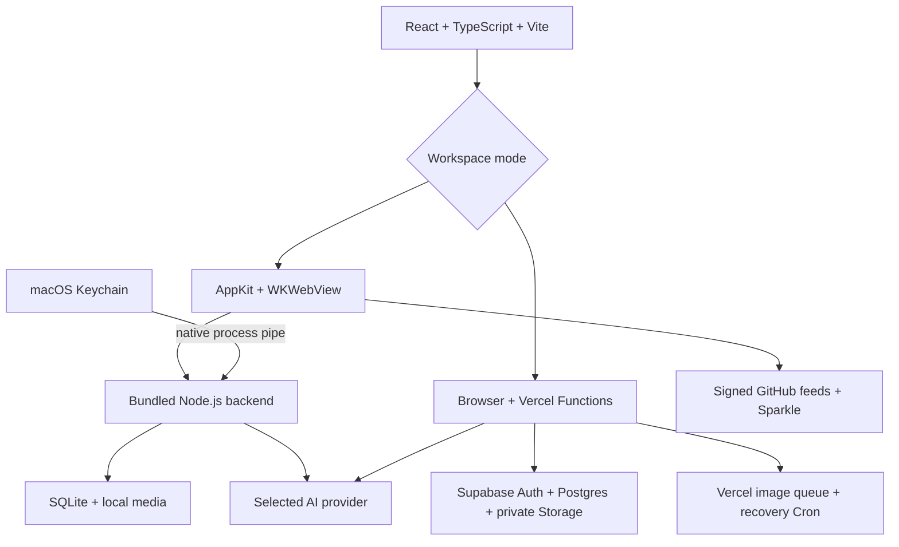

# Develop Banana Studio

[Home](../../README.md) · [Türkçe](../tr/development.md) · [Web deployment](deploy.md) · [Release procedure](../RELEASING.md)

Banana Studio has one React interface and two workspace backends. The standalone desktop app replaces hosted authentication, database, storage and queue adapters with local implementations; it does not embed a configured Supabase project. This repository starts an independent installation and contains no production database or private history.

## Architecture



The local server binds a random loopback port and uses a one-time bootstrap plus an HttpOnly session cookie. Host/origin validation protects local writes. Keys cross the native/backend pipe, not frontend configuration. In cloud mode, backend routes verify the user and access-list membership; user-scoped reads preserve database policies. The privileged server client is reserved for server-owned tasks.

## Source map

| Path | Responsibility |
| --- | --- |
| `src/App.tsx`, `src/index.tsx`, `src/types.ts` | App orchestration, runtime bootstrap and model/UI types |
| `src/components/` | Generation controls, gallery, masks, references and settings |
| `src/services/` | Browser service calls, persistence and provider orchestration |
| `src/lib/images/`, `video/`, `prompts/`, `youtube/`, `brainstorm/`, `references/`, `gallery/` | Shared rules, validation and transformations |
| `src/lib/config/` | Explicit local/cloud runtime configuration; no fallback project |
| `api/` | Hosted Vercel routes and server helpers; keep this at the root for route detection |
| `desktop/server/` | Local HTTP server, SQLite store, uploads, queue and native raster adapter |
| `desktop/shared/` | Query compatibility layer and browser-side local client |
| `desktop/linux/` | GTK/WebKitGTK shell, Secret Service and native smoke tests |
| `desktop/windows/` | WinForms/WebView2 shell and Credential Manager |
| `desktop/macos/` | Native shell, Keychain, bundled process, raster codec and Sparkle |
| `supabase/migrations/`, `supabase/tests/` | Fresh-install schema and isolated access tests |
| `scripts/`, `tests/` | Build, package, signature verification, privacy audits and tests |
| `docs/en/`, `docs/tr/`, `docs/assets/` | Bilingual documentation and original demo artwork |

`runwayService.ts` is a historical filename: current video routes use Seedance through EvoLink/fal.ai/OpenRouter and H3 Max through fal.ai, not a Runway API key. Current choices live in [types.ts](../../src/types.ts); routing and allowlists are the source of truth behind [the provider table](models.md).

## Prerequisites and first checks

Use Node.js **24.x**, npm and Git. Swift/AppKit builds require macOS 13.5+ and Xcode/Swift. Native Mac build commands are not Windows build instructions.

```sh
git clone https://github.com/orkunisitmak/banana-studio.git
cd banana-studio
npm ci --ignore-scripts
npm test
npm run typecheck
npm run build
npm run build:desktop
```

No provider key is required for these builds and synthetic tests. Never use the maintainer's production project or copy credentials from another installation.

## Run the hosted web backend locally

First follow [web setup](deploy.md) with your own test Supabase project, Google OAuth app, provider accounts and Vercel project. Install/authenticate the [Vercel CLI](https://vercel.com/docs/cli), then from the repository root:

```sh
vercel link
vercel env pull .env.local --environment=development
vercel dev
```

Confirm which project/environment you linked before pulling or changing configuration. Use Development credentials separate from production. `.env.local` is ignored and must remain private. Configure the development callback/origin in Google and Supabase for the actual local URL. Hosted Queues/Cron still need deployed verification; a local preview is not proof that scheduled delivery works.

`npm run dev` starts Vite's frontend only. It does not replace Functions, OAuth, background jobs or storage. An unconfigured frontend intentionally displays the setup screen. Server keys must never be exposed using `VITE_*` or bundled into browser code.

For schema changes, use Supabase's migration workflow against your own disposable project. If you used the browser SQL Editor installation, reconcile migration history before a later CLI push; applying the baseline again is not an upgrade. [Supabase CLI documentation](https://supabase.com/docs/reference/cli/introduction).

## Build the Mac app

On a Mac, run the initial checks above, then:

```sh
swift build --package-path desktop/macos -c release
node scripts/fetch-node-runtime.mjs
BANANA_NODE_RUNTIME="$PWD/.build/node-runtime/bin/node" node scripts/package-macos.mjs --development
node scripts/test-local-generation.mjs '.build/staging/Banana Studio.app'
node scripts/test-update-signatures.mjs
open '.build/staging/Banana Studio.app'
```

The runtime helper fetches the pinned official Node runtime for the host architecture and verifies checksums. The packager includes the frontend, local backend, runtime, native codec, Sparkle and dependency notices. Development apps use ad hoc signatures and disable update checks. Test data and build products stay ignored.

Use a disposable workspace for integration tests. The packaged-generation script uses its own temporary SQLite/media and a mocked provider, and checks exact source pixels outside a protected edit. It makes no paid AI request. A successful mock test does not establish billing/model permissions with a real provider account.

## Verify a change

```sh
npm test
npm run typecheck
npm run build
npm run build:desktop
node scripts/audit-public-release.mjs --history
```

For database changes, with PostgreSQL 15+ binaries available:

```sh
PG_TEST_BIN=/path/to/postgresql/bin npm run test:database
```

That script creates and removes an isolated PostgreSQL cluster; it does not connect to a configured cloud workspace. For native changes, run `npm run test:macos`, package the app and exercise the local generation/signature checks above. [.github/workflows/verify.yml](../../.github/workflows/verify.yml) runs web/schema/history checks plus separate Apple Silicon and Intel packaging jobs.

Before publishing a bundle, also run `node scripts/audit-distribution.mjs '.build/staging/Banana Studio.app'` and the independent secret scanner. Source and artifact audits must both pass. [SECURITY.md](../../SECURITY.md) explains limits and responsible reporting.

## Add a provider or model

Update the model types/options, UI capability validation, service routing and backend model/field allowlists together. Add the matching native key field if a new provider is needed. Preserve explicit reference roles, the boundary between generation and manual area edits, and server-only credentials. A new arbitrary upstream URL must not become a key-bearing proxy.

Update both language guides and model tables. Check error/retry behavior and task persistence with synthetic tests before making a bounded real provider call on your own account.

## Contribute and distribute

Fork, make a focused branch, explain the user-visible change and send a pull request with relevant verification. Do not upload private galleries, prompts, real account settings, databases, environment files or provider keys in commits, issues, screenshots or artifacts. Documentation screenshots must use an isolated demo workspace; see [artwork provenance](../assets/README.md).

MIT covers this application's source; dependencies keep their own notices, and AI providers have their own terms. Follow [RELEASING.md](../RELEASING.md) for packaging, licensing, signed archive/feed verification and an actual update test. Fork maintainers need their own bundle ID, Keychain service, Sparkle signing keys and release URLs. The upstream public key does not let you sign updates. Windows packaging and verification run on a Windows CI runner. See the platform guide for the remaining native differences.

## Build the Windows app

On Windows x64, install Node 24 and .NET SDK 8.0.426, then run:

```sh
npm ci --ignore-scripts
npm test
npm run typecheck
npm run build
npm run build:desktop
node scripts/fetch-node-runtime.mjs
node scripts/package-windows.mjs
node scripts/test-local-generation.mjs
```

The app is assembled under `.build/staging-windows/Banana Studio/`. Keep all files together. See [platform behavior](desktop-parity.md) and the [release procedure](../RELEASING.md).

## Build the Linux app

Use glibc Linux x86-64, Node 24, and the [Linux desktop dependencies](../../desktop/linux/README.md).
Ubuntu 24.04 is the CI baseline. After the shared checks above:

```sh
node scripts/fetch-node-runtime.mjs
npm run package:linux
npm run test:linux
python3 desktop/linux/test_shell.py --vault
python3 desktop/linux/test_shell.py --smoke '.build/staging-linux/Banana Studio'
node scripts/test-local-generation.mjs
node scripts/audit-distribution.mjs '.build/staging-linux/Banana Studio'
'.build/staging-linux/Banana Studio/banana-studio'
```

The vault test creates and deletes a synthetic key in a unique test namespace.
The UI smoke test uses an empty vault and disposable SQLite/media, exercises the
real WebKit bootstrap and isolated native bridge, then stops the child server.
It requires a graphical session; use `xvfb-run -a` in headless CI. It makes no paid
requests. A full release still needs manual file-picker, clipboard, video codec,
HiDPI and Wayland/X11 checks on the target distribution.

The archive is `.build/Banana-Studio-<version>-linux-x64.tar.gz`, accompanied by
`verification-linux-x64.json`. Node archives, binaries and licenses are checksum
pinned. Only sharp's installed runtime closure is copied, with its license files.
GTK/WebKitGTK, Python and libsecret remain system dependencies; no WebKit sandbox
is disabled. Keep the whole extracted folder together. Linux updates are manual.
