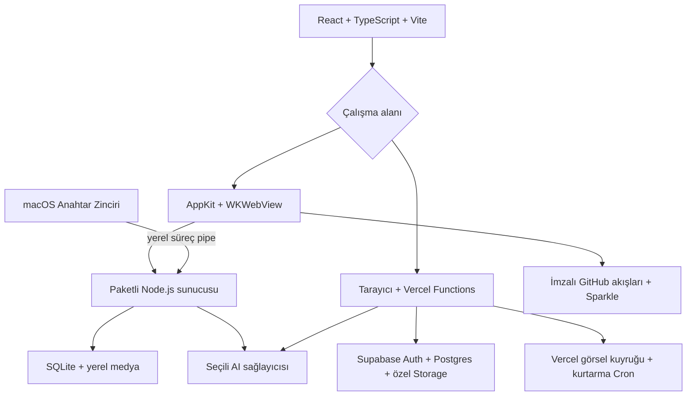

# Banana Studio'yu geliştir

[Ana sayfa](README.md) · [English](../en/development.md) · [Web kurulumu](deploy.md) · [Yayın prosedürü](../RELEASING.md)

Banana Studio tek React arayüzü ve iki çalışma alanı arka ucu kullanır. Bağımsız masaüstü uygulaması; bulut kimlik doğrulaması, veritabanı, depolama ve kuyruk adaptörlerini yerel karşılıklarıyla değiştirir, ayarlanmış bir Supabase projesi taşımaz. Repo bağımsız kurulum başlatır; üretim veritabanı veya özel Git geçmişi içermez.

## Mimari



Yerel sunucu rastgele loopback portunda çalışır; her başlatmada üretilen bootstrap kimlik bilgisi ve HttpOnly oturum çerezi ister. Host/origin kontrolü yerel yazmaları korur. Anahtarlar arayüz ayarından değil, yerel süreç pipe'ından geçer. Webde sunucu kullanıcıyı ve erişim listesi üyeliğini doğrular; kullanıcı kapsamındaki sorgular veritabanı kurallarını korur. Ayrıcalıklı sunucu istemcisi yalnızca sunucunun yönettiği görevler içindir.

## Kaynak haritası

| Yol | Sorumluluk |
| --- | --- |
| `src/App.tsx`, `src/index.tsx`, `src/types.ts` | Uygulama akışı, açılış ayarı, model ve arayüz tipleri |
| `src/components/` | Üretim kontrolleri, galeri, maske, referans ve ayarlar |
| `src/services/` | Tarayıcı servis çağrıları, kayıt ve sağlayıcı akışları |
| `src/lib/images/`, `video/`, `prompts/`, `youtube/`, `brainstorm/`, `references/`, `gallery/` | Ortak kurallar, doğrulama ve dönüşümler |
| `src/lib/config/` | Açık yerel/bulut çalışma ayarı; varsayılan özel proje yok |
| `api/` | Vercel uçları ve sunucu yardımcıları; rota algılaması için kökte kalır |
| `desktop/server/` | Yerel HTTP sunucusu, SQLite, yükleme, kuyruk ve raster adaptörü |
| `desktop/shared/` | Sorgu uyumluluk katmanı ve tarayıcının yerel istemcisi |
| `desktop/macos/` | Yerel kabuk, Anahtar Zinciri, süreç, raster codec ve Sparkle |
| `supabase/migrations/`, `supabase/tests/` | Yeni kurulum şeması ve izole erişim testleri |
| `scripts/`, `tests/` | Derleme, paketleme, imza, gizlilik taraması ve testler |
| `docs/en/`, `docs/tr/`, `docs/assets/` | İki dilde belgeler ve özgün demo çizimleri |

`runwayService.ts` geçmişten kalan dosya adıdır; mevcut video bağlantıları Runway anahtarı kullanmaz, Seedance/EvoLink ve H3 Max/fal.ai kullanır. Model seçenekleri [types.ts](../../src/types.ts) içindedir; [sağlayıcı tablosunun](models.md) doğruluk kaynağı servis yönlendirmeleri ve sunucu izin listeleridir.

## Gereksinimler ve ilk kontroller

Node.js **24.x**, npm ve Git kullan. Swift/AppKit için macOS 13.5+ ve Xcode/Swift gerekir. Mac derleme komutları Windows paketi oluşturmaz.

```sh
git clone https://github.com/orkunisitmak/banana-studio.git
cd banana-studio
npm ci --ignore-scripts
npm test
npm run typecheck
npm run build
npm run build:desktop
```

Bu derlemeler ve sentetik testler için sağlayıcı anahtarı gerekmez. Başka kurulumun veya proje sahibinin özel hesap bilgilerini kopyalama.

## Web sunucusunu yerelde çalıştır

Önce kendi test Supabase projen, Google OAuth uygulaman, sağlayıcı hesapların ve Vercel projenle [web rehberini](deploy.md) tamamla. [Vercel CLI'ı](https://vercel.com/docs/cli) kurup oturum aç, ardından repo kökünde:

```sh
vercel link
vercel env pull .env.local --environment=development
vercel dev
```

Ayar çekmeden/değiştirmeden önce bağlı proje ve ortamı kontrol et. Development için üretimden ayrı bilgiler kullan. `.env.local` Git tarafından dışlanır, özel kalmalıdır. Gerçek yerel URL için Google/Supabase origin ve callback ayarlarını ekle. Bulut Queues/Cron davranışını deploy üzerinde de doğrula; yerel önizleme zamanlanmış teslimatın kanıtı değildir.

`npm run dev` yalnızca Vite arayüzünü başlatır; Functions, OAuth, arka plan işleri veya depolamanın yerine geçmez. Ayarlanmamış arayüz özellikle kurulum ekranı gösterir. Sunucu anahtarlarını `VITE_*` ile veya arayüz koduna ekleyerek açma.

Şema değişikliklerini kendi geçici projende Supabase migration akışıyla yap. Tarayıcı SQL Editor yoluyla kurduysan sonraki CLI push öncesinde migration geçmişini eşleştir; başlangıç SQL'ini tekrar uygulamak güncelleme değildir. [Supabase CLI belgeleri](https://supabase.com/docs/reference/cli/introduction).

## Mac uygulamasını derle

Mac'te yukarıdaki ilk kontrollerden sonra:

```sh
swift build --package-path desktop/macos -c release
node scripts/fetch-node-runtime.mjs
BANANA_NODE_RUNTIME="$PWD/.build/node-runtime/bin/node" node scripts/package-macos.mjs --development
node scripts/test-local-generation.mjs '.build/staging/Banana Studio.app'
node scripts/test-update-signatures.mjs
open '.build/staging/Banana Studio.app'
```

Yardımcı script, işlemciye uygun sabitlenmiş resmî Node runtime'ını indirip checksum kontrol eder. Paketleyici; arayüz, yerel sunucu, runtime, yerel codec, Sparkle ve lisans bildirimlerini ekler. Geliştirme uygulaması ad hoc imza kullanır, güncelleme kontrolü kapalıdır. Test verileri ve derleme çıktıları Git dışında kalır.

Entegrasyon testlerinde geçici alan kullan. Paketli üretim script'i kendi geçici SQLite/medyası ve sahte sağlayıcısıyla çalışır; korumalı düzenlemede dış pikselleri birebir kontrol eder. Ücretli AI isteği yapmaz. Bu testin geçmesi gerçek sağlayıcı hesabının ödeme/model yetkisini kanıtlamaz.

## Değişikliği doğrula

```sh
npm test
npm run typecheck
npm run build
npm run build:desktop
node scripts/audit-public-release.mjs --history
```

Veritabanı değişikliğinde PostgreSQL 15+ araçlarıyla:

```sh
PG_TEST_BIN=/path/to/postgresql/bin npm run test:database
```

Script ayrı ve geçici PostgreSQL kümesi oluşturup kaldırır; ayarlanmış bulut alanına bağlanmaz. Yerel uygulama değişikliğinde `npm run test:macos`, paketleme ve yukarıdaki üretim/imza kontrollerini çalıştır. [.github/workflows/verify.yml](../../.github/workflows/verify.yml), web/şema/geçmiş kontrolleri ile Apple Silicon ve Intel paketlemeyi ayrı çalıştırır.

Paket yayımlamadan önce `node scripts/audit-distribution.mjs '.build/staging/Banana Studio.app'` ve bağımsız secret tarayıcısını da çalıştır. Hem kaynak hem paket denetimi geçmelidir. [SECURITY.md](../../SECURITY.md), sınırları ve sorumlu bildirim yolunu açıklar.

## Model veya sağlayıcı ekle

Model tip/seçeneklerini, arayüz yetenek kontrolünü, servis yönlendirmesini ve sunucudaki model/alan izin listelerini birlikte güncelle. Yeni servis gerekiyorsa yerel anahtar kutusunu da ekle. Referans rollerini, normal üretim ile elle seçilen alan düzenleme ayrımını ve anahtarların yalnızca sunucuda kalmasını koru. Rastgele bir upstream URL'yi anahtar taşıyan proxy'ye dönüştürme.

İki dilde rehberi ve model tablosunu güncelle. Kendi hesabında sınırlı gerçek çağrı yapmadan önce hata/tekrar deneme ve görev kaydını sentetik testlerle doğrula.

## Katkı ve dağıtım

Fork al, odaklı dal oluştur, kullanıcıya etkisini açıkla ve ilgili kontrollerle pull request gönder. Özel galeri, prompt, gerçek hesap bilgisi, veritabanı, ortam dosyası veya anahtarı commit, issue, ekran görüntüsü veya artifact'e koyma. Belge görsellerinde ayrı demo alanı kullan; [görsel kaynakları](../assets/README.md).

Uygulama kodu MIT'dir; bağımlılıklar kendi lisanslarını, sağlayıcılar kendi koşullarını korur. Paketleme, lisans, imzalı arşiv/akış ve gerçek güncelleme testi için [RELEASING.md](../RELEASING.md) dosyasını izle. Fork yayımlayanlar kendi bundle ID, Anahtar Zinciri servisi, Sparkle imza anahtarları ve yayın adreslerini kullanmalıdır. Upstream public anahtar güncelleme imzalama yetkisi vermez. Windows paketleme ve doğrulama Windows CI üzerinde çalışır. Yerel farklar platform rehberinde açıklanmıştır.

## Windows uygulamasını derle

Windows x64 üzerinde Node 24 ve .NET SDK 8.0.426 kur, ardından çalıştır:

```sh
npm ci --ignore-scripts
npm test
npm run typecheck
npm run build
npm run build:desktop
node scripts/fetch-node-runtime.mjs
node scripts/package-windows.mjs
node scripts/test-local-generation.mjs
```

Paket `.build/staging-windows/Banana Studio/` altında oluşur. Dosyaları bütün olarak tut. [Platform davranışları](desktop-parity.md) ve [yayın prosedürü](../RELEASING.md).

## Bağımsız Linux masaüstü

Ubuntu/CachyOS gereksinimleri, komutlar ve doğrulanması gereken Linux kontrolleri için [Linux masaüstü kılavuzuna](linux-alpha.md) bakın. Ayrı Electron kabuğu mevcut arayüzü ve yerel sunucuyu kullanır.
